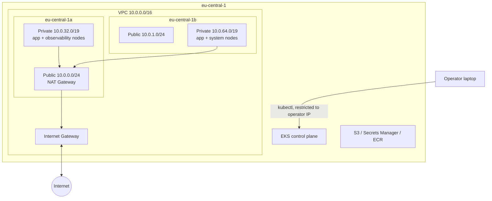

# AWS deployment design

The test-bed runs on Amazon EKS in eu-central-1, migrated from k3s on Hetzner.

## Network
| Subnet    | Zone          | CIDR          | Purpose        |
|-----------|---------------|---------------|----------------|
| VPC       |               | 10.0.0.0/16   |                |
| public-a  | eu-central-1a | 10.0.0.0/24   | NAT Gateway    |
| public-b  | eu-central-1b | 10.0.1.0/24   | Reserved       |
| private-a | eu-central-1a | 10.0.32.0/19  | Nodes and pods |
| private-b | eu-central-1b | 10.0.64.0/19  | Nodes and pods |

Worker nodes run in private subnets with outbound access through a single
NAT Gateway. Private subnets are sized for pod IPs, since the VPC CNI assigns
every pod an address from the subnet.

## Cluster access
The EKS API endpoint is public, restricted to the operator's IP, with private
access enabled for in-VPC traffic.

## Node groups
| Group         | Instances     | Workloads                                   |
|---------------|---------------|---------------------------------------------|
| application   | 2 × t3.large  | Online Boutique                             |
| observability | 1 × t3.large  | Prometheus, Grafana, Loki                   |
| system        | 1 × t3.medium | Chaos Mesh controllers, CoreDNS, operators  |

Observability and system components run on separate node groups so that
fault injection on the application tier cannot affect measurement or the
chaos tooling.

## Cost
| Usage        | Approx. monthly cost |
|--------------|----------------------|
| 80 h/month   | ~$42                 |
| 200 h/month  | ~$102                |
| 24/7         | ~$370                |

The cluster is destroyed after every session.

## Architecture
